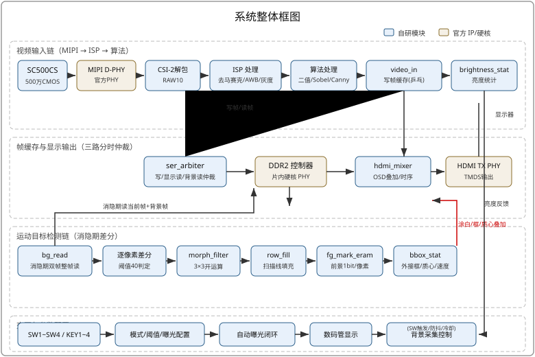
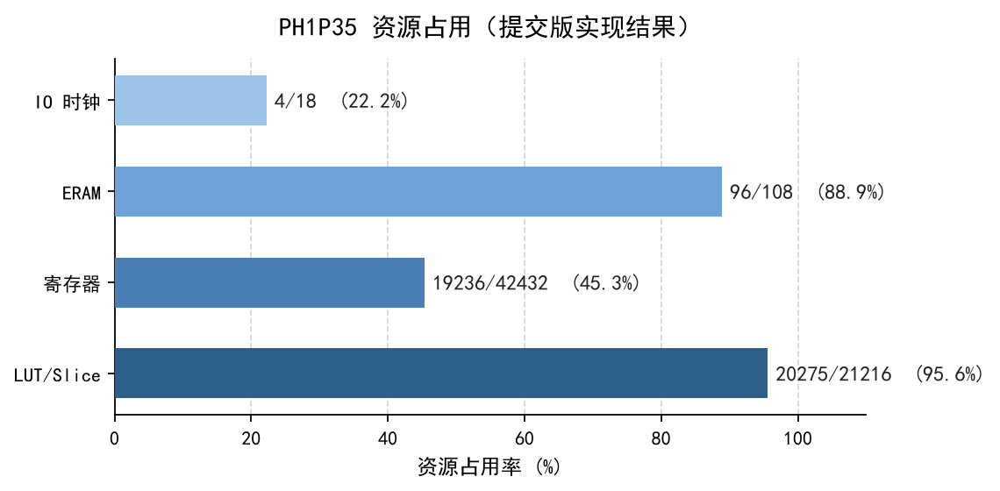

# 安路FPGA运动目标检测与跟踪

基于安路科技 PH1P35 FPGA 的实时运动目标检测与图像处理系统。720P60 全链路纯硬件流水线：MIPI 采集 → ISP → DDR 帧缓存 → 背景减除式运动检测 → HDMI 实时输出。

   

## ✨ 功能特性

- **视频采集与显示**：SC500CS 摄像头（MIPI CSI-2 双通道）→ 坏点校正/去马赛克/白平衡 ISP → HDMI 720P60 实时输出
- **四种图像算法在线切换**：灰度化、二值化、Sobel、Canny（两级高斯+非极大值抑制），按键循环切换
- **背景减除式运动目标检测与跟踪**：消隐期双帧整帧差分 → 形态学开运算去噪 → 扫描线区域填充 → 外接框 + 质心坐标 + 速度向量实时叠加
- **自动曝光闭环**：亮度统计反馈调节曝光/增益，自动/手动一键切换，AE 变化自动重采背景
- **全在线参数调节**：曝光、增益、二值/Sobel 阈值全部拨码+按键实时调节，数码管同步显示
- **OSD 信息叠加**：当前模式、曝光/增益、帧号、阈值、质心坐标、Logo

## 系统框图



## 目录结构

```
├── src/                    # 全部设计源码
│   ├── hdl_source_clean/   #   自研 Verilog 模块（40+）
│   ├── hdl_source_ip/      #   官方 IP 封装（MIPI D-PHY / DDR2 / HDMI）
│   └── constraints_source/ #   引脚约束 pin.adc + 时序约束 timing.sdc
├── prj/                    # TD 工程文件（FPGACompetition.al + al_ip）
├── sim/                    # 仿真 testbench + 回归脚本（iverilog/verilator）
├── docs/
│   ├── 技术报告.md/.pdf    #   竞赛技术报告
│   ├── 模块实现详解.md      #   每个模块的设计说明（思路→关键代码→用法）
│   ├── 踩坑记录.md          #   开发全程的坑、根因与教训
│   ├── 迭代清单.md          #   fuse19~22 迭代历史与验证清单
│   └── 演示视频脚本.md      #   演示视频分镜脚本
└── images/                 # 框图、实物照、资源统计图
```

## 快速开始

### 编译

1. 安装安路 TD 6.2（本项目使用 6.2.168116 版本）
2. TD GUI 打开 `prj/FPGACompetition.al`
3. 直接运行综合 + 布局布线 + 生成 bit（首次打开会自动重建 Runs 目录）
4. bit 输出：`prj/FPGACompetition_Runs/phy_1/FPGACompetition.bit`

> ⚠️ 工程路径必须全英文（TD 要求）；全流程编译约 50 分钟。

### 下载与运行

1. USB-JTAG 下载 bit，或烧写 SPI Flash
2. 上电后显示器出现实时画面；黑屏先按 KEY1 复位
3. 拨码开关全部拨上为默认状态

### 操作说明

| 操作 | 功能 |
|---|---|
| SW1/SW2 | 数码管显示档与参数调节对象选择（0 曝光/目标亮度、1 增益、2 二值阈值、3 Sobel 阈值） |
| SW3 | 手动曝光使能（高 = 手动可调） |
| SW4 | 采背景（拨下触发，100ms 防抖后采一帧） |
| SW3+SW4 | 区域填充模式（运动目标填实色块） |
| SW3 单独 | 外接框 + 质心模式 |
| KEY1 | 系统复位 |
| KEY2/KEY3 | 参数减/加（长按 200ms/tick 连续调） |
| KEY4 短按 | 算法切换（原样 → 灰度 → 二值 → Sobel） |
| KEY4 长按 | 自动/手动曝光切换 |

## 资源占用与性能（提交版实测）

- 时序：SWNS 0.126ns / HWNS 0.020ns，0 违例
- 资源：Slice 95.56%（20275/21216）、寄存器 45.33%、ERAM 88.89%（96/108）
- 处理延迟：像素级流水线（< 1 帧），720P60 全程不掉帧


